<picture>
  <source media="(prefers-color-scheme: dark)" srcset="assets/demo-dark.svg">
  <source media="(prefers-color-scheme: light)" srcset="assets/demo-light.svg">
  
</picture>

Just like organizing pages in Notion or Bear, this plugin lets you give notebooks, folders, and notes distinct icons and colors so you can spot the right file in the sidebar at a glance.

- **96 icons with fast search**: Browse 8 categories (Documents, Work, Development, Study, Life, Nature, Ocean, Symbols), search by English or Chinese keywords, and revisit recent picks.
- **7 adaptive colors**: Choose from Default, Blue, Teal, Green, Amber, Red, and Purple, tuned to look clean in both light and dark themes.
- **Click or right-click to change**: Click any notebook, file, or folder icon in the sidebar or titlebar, or use the right-click menu to open the picker.
- **Tab sync and one-click reset**: Toggle click-to-pick or top tab icon sync anytime in plugin settings, or clear all custom icons for the current notebook in one click.

**Install**: Open Block Settings -> App Store and search **Custom Icons**, or enter `blockmd-plugins/block-file-icons`.
