<picture>
  <source media="(prefers-color-scheme: dark)" srcset="assets/demo-dark.svg">
  <source media="(prefers-color-scheme: light)" srcset="assets/demo-light.svg">
  
</picture>

像在 Notion 或 Bear 里整理页面一样，给笔记本、文件夹和笔记换上不同图案与颜色的小图标，让侧栏层次更清楚，一眼就能找到想打开的文件。

- **96 款图标随手搜**：涵盖文档、工作、开发、学习、生活、自然、海洋与符号 8 大分类，支持中英文关键词搜索，还会记住最近用过的图标。
- **7 种配色自动适配**：提供原色、海蓝、青绿、森绿、琥珀、朱红、紫罗兰 7 种柔和色调，浅色与深色主题下都和谐耐看。
- **点击或右键就能换**：直接点击笔记本图标或侧栏文件/文件夹前面的图标，或通过右键菜单即可打开选择器。
- **标签页同步与清空**：在插件设置页可按需关闭点击更换或顶部标签页图标同步，也支持一键清空当前笔记本的全部自定义图标。

**安装**：打开 Block「设置 → 应用商店」搜索 **自定义图标**，或手动填入 `blockmd-plugins/block-file-icons`。
